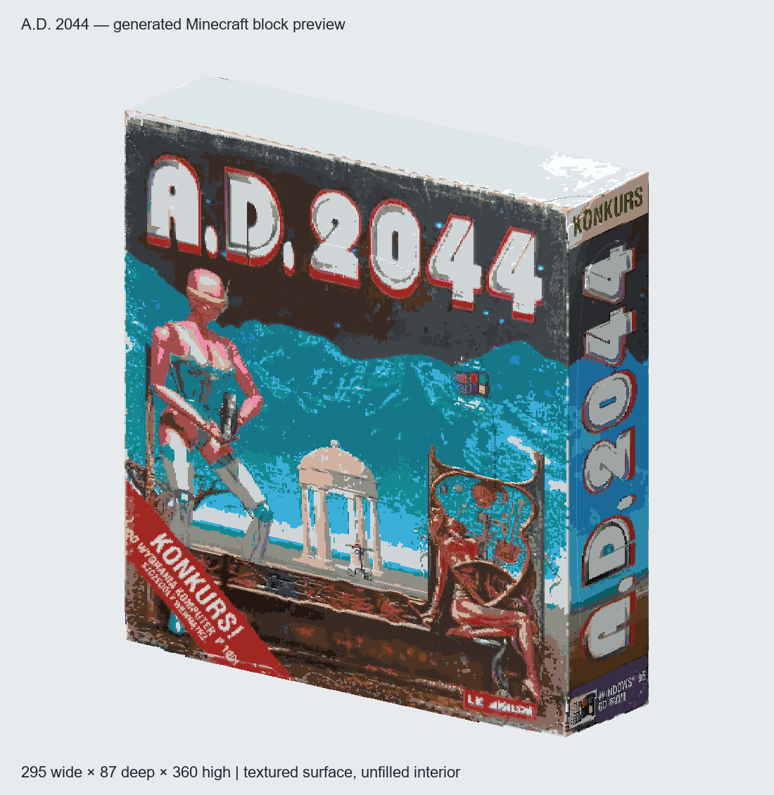

# A.D. 2044 game box

A static Minecraft Bedrock sculpture converted from `glb/ad2044.glb`. It retains
the original proportions, photographed artwork on all six faces, worn edges and
small modeled dents. This is the game box itself, with an unfilled interior.



## Place the build

1. Import `packs/19_ad2044.mcpack` and activate **version 1.0.32** in a world
   with cheats enabled. Close and reopen an existing world after updating.
2. Use a clear, flat Overworld site. Stand at ground level with feet at
   **Y -63 through -42**. Default Classic Flat ground at **Y -60** is supported.
3. Face the intended build direction and look horizontally. The function
   centers you and snaps your view to the nearest cardinal direction.
4. Run **`/function 19_ad2044` once**. Keep three command-created ticking-area
   slots free. Leave the temporary anchor and its original ground intact until
   completion; you may move and turn after starting.

The observation origin is in front of the box's center. Its nearest surface is
**32 blocks ahead**; front artwork faces you with readable lettering. Reserve
**295 wide x 87 deep x 360 high**, from `^-147 ^1 ^32` through `^147 ^360 ^118`.
The bottom surface is one block above your feet. At Classic Flat height the
structure occupies absolute Y **-59 through 300**. Every asset's complete
bounding box fits within the Overworld height limit at the supported heights.

Back up first or use a disposable world: occupied surface cells replace
existing blocks. Omitted interior and exterior cells leave the world unchanged.
There is no interior clearing, gameplay logic, or scripted animation.

The root `ai-minecraft-builds.mcpack` is the complete collection alternative.
Rebuild and reimport the relevant pack after changing functions, structures or
the manifest. Importing alone does not switch an already-open world's active
pack version.

## Measured conversion

| Property | Result |
| --- | --- |
| Public entry point | `19_ad2044` |
| Source | `ad2044.glb`, GLB 2.0, little-endian, 8,514,256 bytes |
| Mesh | 10,062 vertices, 19,136 explicit triangle faces |
| Scene | One closed exterior mesh, one identity-transform node; nothing excluded |
| Texture | One embedded 4096 x 4096 RGB photograph atlas, opaque material |
| Uniform scale | 1,380.769281416 blocks per source unit |
| Orientation | Caret left = -model X; up = model Y; forward = -model Z |
| Dimensions | 295 width, 87 depth, 360 height |
| Occupied blocks | 321,519 |
| Used materials | 39 vanilla concrete, wool and terracotta colors |
| Explicit air cells | 0 |
| Best tested exact cuboid encoding | 70,674 placement commands, before wrapper commands |
| Native structures | 20, partitioned along X, Y and Z |
| Largest asset dimensions | 64 x 257 x 64 |
| Public commands | 39, including the five cardinal snap commands |
| Internal callback commands | 198: two readiness commands and 196 lifecycle commands |
| Total lifecycle commands | 237 |
| Peak owned ticking areas | 3: two plot rectangles plus one origin circle |
| Plot rectangle chunk maximum | 77 each, including worst-case chunk alignment |

Each triangle is sampled on a barycentric grid at least three times per block
along its longest edge. The nearest sampled surface supplies a deduplicated
voxel's bilinearly sampled texture color; stable sample order breaks exact
ties. This rasterizes faces rather than only quantizing vertices. No solid
interior or background geometry is added.

Texture colors map to the closest Euclidean CIELAB (D65) value among 49 candidate
vanilla blocks, using each official block texture's mean sRGB. Thirty-nine are
used in the finished build. There is no dithering. The pinned Minecraft 1.21.50
resource source, block names, means and texture hashes are in [palette.json](palette.json).
The [front](front.png), [back](back.png) and [overview](overview.png) images show
generated blocks colored by these means; actual Minecraft lighting and block
texture detail vary.

## Loader and validation

Exactly three functions implement installation. The public function validates
the player, Overworld and supported height, preserves an active install, saves
the snapped origin/facing and installation generation in a protected temporary
armor stand, clears only this build's stale state, and schedules startup two
ticks later. This barrier lets stale ticking-area removal finish before names
are reused.

The lifecycle callback explicitly restores the saved dimension, position,
rotation and generation, creates the three preloads and starts a 3,600-tick
watchdog. Both plot rectangles must report ready. The readiness callback only
counts readiness and schedules a 600-tick settle period; it never places
structures. The lifecycle callback then checks **three blocks in every asset**
before announcing completion. Missing readiness, a lost or old-generation
anchor, or failed block samples aborts with cleanup. An abort retains already
placed blocks. Unrelated ticking areas are left intact.

The generator parses every generated NBT file back to the complete voxel and
material map, checks dimension limits and both index layers, and compares the
complete scene across all four rotations. Full asset boxes are checked against
world Y limits. Exact runs in three axes and exact cuboid partitions in six
axis orders all exceed the standalone 10,000-command limit. See
[metrics.json](metrics.json) for source metadata, bounds, palette usage, asset
boxes, sample locations and production function hashes.

Real-engine results are recorded separately in
[bedrock_runtime_check.json](bedrock_runtime_check.json). The headless harness
uses a test-only armor-stand entry point in a disposable copy of a Classic Flat
world. Production callbacks, timers, assets and sample audits remain in use.
Bedrock Dedicated Server 1.26.52.3 passed installations in all four facings at
feet Y -60, each with 60 initially-air samples across all 20 assets. Busy
reentry preserved the installation generation; driver movement/turning did not
change placement. Stale ticking-area recovery, old marker generation,
unsupported height, insufficient area slots and final cleanup were checked.
Failure cases invoked the production watchdog dispatcher explicitly rather
than waiting the entire 3,600-tick timeout. The report pins the tested pack,
structure and production function hashes. The check samples every asset region;
it does not compare every block in the engine or establish interactive player
behavior.

## Regenerate and check

Python requires NumPy and Pillow. The first generation downloads block-color
references from Mojang's pinned Bedrock samples; subsequent runs use the saved
palette. The GLB is an input and is never rewritten.

```powershell
$env:PYTHONDONTWRITEBYTECODE='1'
python tools/generate_ad2044.py
python tools/generate_ad2044.py --check
python tools/cardinal_snap.py --check
powershell -NoProfile -ExecutionPolicy Bypass -File tools/package_builds.ps1
git diff --check
```

`--refresh-palette` deliberately refreshes the pinned official color references.
The generator preserves existing text-file line endings and writes new
functions with LF. Generated previews, metrics and palette data stay outside
the behavior pack.

With an existing Bedrock Dedicated Server binary and a Classic Flat world:

```powershell
python tools/validate_ad2044_bedrock.py --server PATH/bedrock_server.exe --flat-world PATH/TO/CLASSIC_FLAT_WORLD
```

This creates an isolated server and world copy under the system temporary
directory. It does not edit the supplied world or server installation. Only the
separate test entry point relaxes player type checks. Test fixtures never enter
the shipped archive.

Official command references: [structure loading](https://learn.microsoft.com/en-us/minecraft/creator/commands/commands/structure?view=minecraft-bedrock-stable),
[scheduling](https://learn.microsoft.com/en-us/minecraft/creator/commands/commands/schedule?view=minecraft-bedrock-stable),
[ticking areas](https://learn.microsoft.com/en-us/minecraft/creator/commands/commands/tickingarea?view=minecraft-bedrock-stable),
and [execution context](https://learn.microsoft.com/en-us/minecraft/creator/commands/commands/execute?view=minecraft-bedrock-stable).
