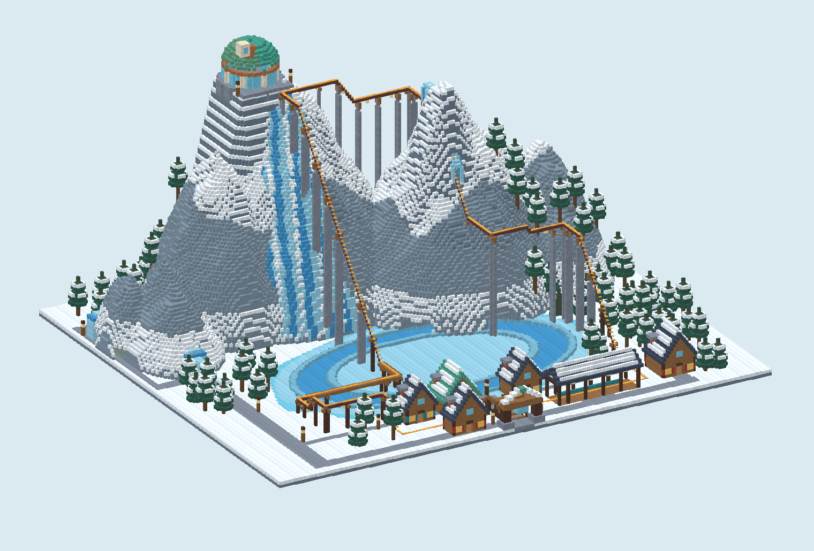
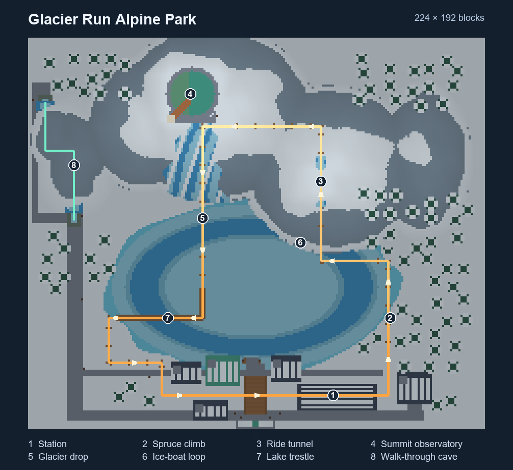

# Glacier Run Alpine Park



## Build and visit

Import and activate `packs/22_theme_park_glacier_run_alpine_park.mcpack` version **1.0.42** in a Bedrock world with cheats enabled. Close and reopen the world to load the functions. Use a disposable or backed-up world.

Stand on level ground in the Overworld, facing a cardinal direction and looking horizontally. Your feet can be from **Y -62 through 231**, including **Y -60** on Classic Flat. From your front-center approach, reserve **224 × 192 × 91 blocks** from `^-112 ^-2 ^24` through `^111 ^88 ^215`. The two base layers extend below your feet.

Keep four ticking-area slots free and run `/function 22_theme_park_glacier_run_alpine_park` once. The park snaps to your facing and keeps building from the saved origin if you move. Leave the starting ground intact and wait for the completion message. The installer waits for three plot preloads, loads all 12 structures, checks 28 placement samples, and removes its temporary areas and marker.



| Attraction | Reach it from the entrance |
| --- | --- |
| **Glacier Run coaster** | Turn right onto the lower station path before the footbridge. Stand beside the rail at `^-39 ^0 ^38` and place a plain minecart at `^-39 ^0 ^40`. Enter and start it toward negative local X, to the right when facing into the park. |
| **Frozen lake** | Cross the village footbridge to the dock at `^2 ^0 ^57`. Walk through the break in the curb and place a plain boat on the blue-ice lane near `^2 ^0 ^63`. The route runs in both directions and passes beneath the coaster. |
| **Walk-through glacier cave** | Follow the lower path to the left and turn toward the mountains. The lit entrance is near `^89 ^0 ^132` and the exit is near `^103 ^0 ^182`. Follow the outside path back to the village. |

The **538-rail** coaster has **10 curves**, three major climbs, and two major drops. It climbs through spruce woods, passes through the high ice tunnel and over the saddle, and runs beside the summit observatory before its **66-block drop** to the lake trestle. The station rail is level. The observatory and telescope are static ride scenery.

## Regeneration and checks

```powershell
$env:PYTHONDONTWRITEBYTECODE = '1'
python tools/generate_glacier_run.py
python tools/generate_glacier_run.py --check
powershell -NoProfile -ExecutionPolicy Bypass -File tools/package_builds.ps1
```

The generator uses Python, NumPy, and Pillow. It checks block names and states against Mojang's 1.21.50 data. It also verifies all four cardinal NBT cell maps, rail continuity and state rotation, boat lane clearance, and walking access from the entrance to both cave portals, the dock, the chalets, and the station. [Mojang block catalog](https://github.com/Mojang/bedrock-samples/blob/v1.21.50.7/metadata/vanilladata_modules/mojang-blocks.json) · [Asset bounds and samples](metrics.json)

Bedrock Dedicated Server 1.26.52.3 loaded the park at Classic Flat Y -60 in all four directions. Each run verified 28 blocks across all 12 assets, all 538 rail states, and removal of the temporary areas and marker. The test also checked stale-area recovery, interrupted starts, and both height boundaries. An empty minecart passed all 11 checkpoints and returned to the station. Interactive coaster and boat playtesting remains outstanding. [Runtime report](bedrock_runtime_check.json)

The 12 structures contain **606,593 non-air blocks** and **34,322 explicit air cells** for interiors and clearance. The best checked exact cuboid encoding used 19,080 placement commands before the cardinal snap. Rebuild and reimport the pack after changing packaged files.
