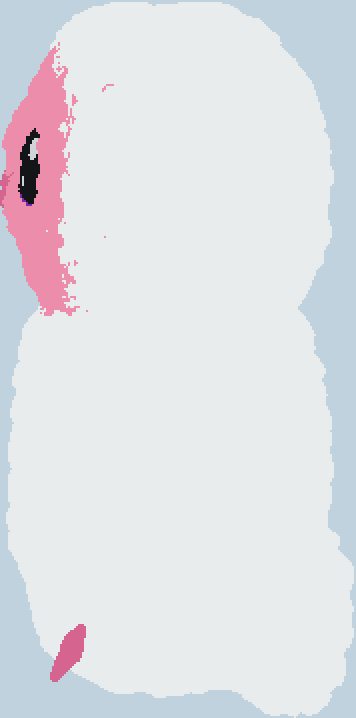

# Pink plush bird

Official release 1: a static Minecraft Bedrock sculpture made from
`glb/pink_plush_bird.glb`, with rounded white fleece, a pink face, purple eye
rims, bright eye catchlights and hidden fill lighting. The images are generated
block previews, not game screenshots.


## Install and place

Import and activate `packs/20_pink_plush_bird.mcpack` **pack version 1.0.35**,
enable cheats, close/reopen the world, then run once as a player:

```mcfunction
/function 20_pink_plush_bird
```

Use a disposable world or make a backup. Stand at ground level in the Overworld,
face a cardinal direction, and look horizontally. The function centers you on
the current block and snaps facing automatically. Classic Flat ground at feet
**Y -60** works; the supported feet-Y range is **-63 through -42**.

Reserve a clear **250 wide x 178 deep x 359 high** site, from
`^-124 ^2 ^32` through `^125 ^360 ^209`. The front-center observation point is
**32 blocks before the nearest block**. Source +Z faces you, with left/right preserved. All asset boxes
fit within absolute Y -58 through 300 when your feet are at Y -60.

Keep **four command-created ticking-area slots free**. One saves the origin;
three preload the plot, each conservatively at most 85 chunks regardless of
world-chunk alignment. You may move and turn after starting. Keep the saved
origin's ground and temporary marker intact, and leave the world running until
completion. Do not run another copy of this loader while it is active.

The loader waits two ticks after removing its stale areas, then restores the
saved position, dimension, facing and installation generation for placement.
All four areas must report ready. After a 600-tick settle delay, it checks
**72 block samples, three per structure**, before reporting success and removing
its areas and marker. A 3,600-tick watchdog handles a missing area or anchor.
Duration depends on device performance. Failure retains blocks already placed.

The individual pack contains only this build. `ai-minecraft-builds.mcpack` at
repository root is the complete debug alternative. Rebuild and reimport after
changing any packaged function, structure, or manifest.

## Conversion and measurements

All 68 source meshes are sampled: 3,275,283 vertices and 5,948,432 triangles,
with a uniform scale of 1,263.568526177 blocks per source unit. Scene transforms
are applied. `source_metadata.json` records source materials, hierarchy and
texture dimensions. The source GLB is unchanged.

The visual pass closes short gaps between yarn strands, rounds their tips with
a Gaussian filter and retains a two-block outer skin. The head cap and body use
white wool; the face uses pink wool, with purple restricted to the eye rims.
The beak and webbed feet use pink concrete. White catchlights follow the domed
black eye surfaces. Wings, tail, care label, proportions and silhouette follow
the source model.

Invisible `minecraft:light_block_15` blocks just outside the skin supply fill
light to the neck, belly, undersides and face on a four-block grid. The pack
does not change world time, weather, brightness or global lighting settings.
It requires no resource pack or script. Empty cells use **-1**, leaving exterior
voids and the deep interior untouched. **No explicit air blocks are placed.**

| Output | Count |
| --- | --- |
| Visible sculpture blocks | 371,768 |
| Invisible level-15 lights | 18,806 |
| Public function commands, including five snaps | 40 |
| Commands across two internal callbacks | 235 |
| Best exact tested cuboid encoding | 77,411 commands |
| Native structures | 24 |

`metrics.json` records exact placement and visible bounds, material counts,
compression results, asset sizes and hashes, placement samples and function
hashes. Every structure stays within 64 x 257 x 64. There is one public function
and exactly two internal callbacks.




## Validation and regeneration

`bedrock_runtime_check.json` pins the tested engine, pack version and hashes.
The headless harness tests all four facings at feet Y -60, checks 72 visible
blocks across all 24 assets, and reads seven neck/belly light probes at midnight.
It also exercises busy reentry, stale owned areas, marker-generation mismatch,
missing markers, capacity failure and final cleanup. Interactive client visual
inspection remains outstanding; the previews above show generated blocks.

Every asset is parsed back as little-endian NBT to EOF. Validation checks root
layout, palette/state/version values, both index layers, dimensions, occupied
counts and every voxel. All four structure rotations are simulated for every
occupied voxel and material. Whole asset boxes are checked at feet Y -60.
The Windows packager validates dependencies. Generated archives are checked
against source bytes, dependency paths, manifest versions and unique pack
identities. Existing text line endings are preserved; functions use LF.

Python requires NumPy, SciPy and Pillow. Run from the repository root:

```powershell
$env:PYTHONDONTWRITEBYTECODE='1'
python tools/generate_pink_plush_bird.py
python tools/generate_pink_plush_bird.py --check
python tools/cardinal_snap.py --check
powershell -NoProfile -ExecutionPolicy Bypass -File tools/package_builds.ps1
git diff --check
```

For headless runtime checks, supply a Bedrock Dedicated Server and a Classic
Flat world. The harness makes an isolated copy in the system temporary directory
and leaves both inputs untouched:

```powershell
python tools/validate_pink_plush_bird_bedrock.py --server PATH/bedrock_server.exe --flat-world PATH/TO/CLASSIC_FLAT_WORLD
```

The harness uses a separate test entry point whose player type guards accept
an armor stand. A test-only Script API 2.10.0 observer reads actual light levels;
it never enters the shipped archive. Production callbacks, assets, timers and
placement checks remain unchanged. Failure cases invoke the production watchdog
dispatcher without waiting the full timeout. Runtime checks sample regions
rather than compare every engine block.

Official references: [structure load](https://learn.microsoft.com/en-us/minecraft/creator/commands/commands/structure?view=minecraft-bedrock-stable),
[scheduling](https://learn.microsoft.com/en-us/minecraft/creator/commands/commands/schedule?view=minecraft-bedrock-stable),
[ticking areas](https://learn.microsoft.com/en-us/minecraft/creator/commands/commands/tickingarea?view=minecraft-bedrock-stable).
