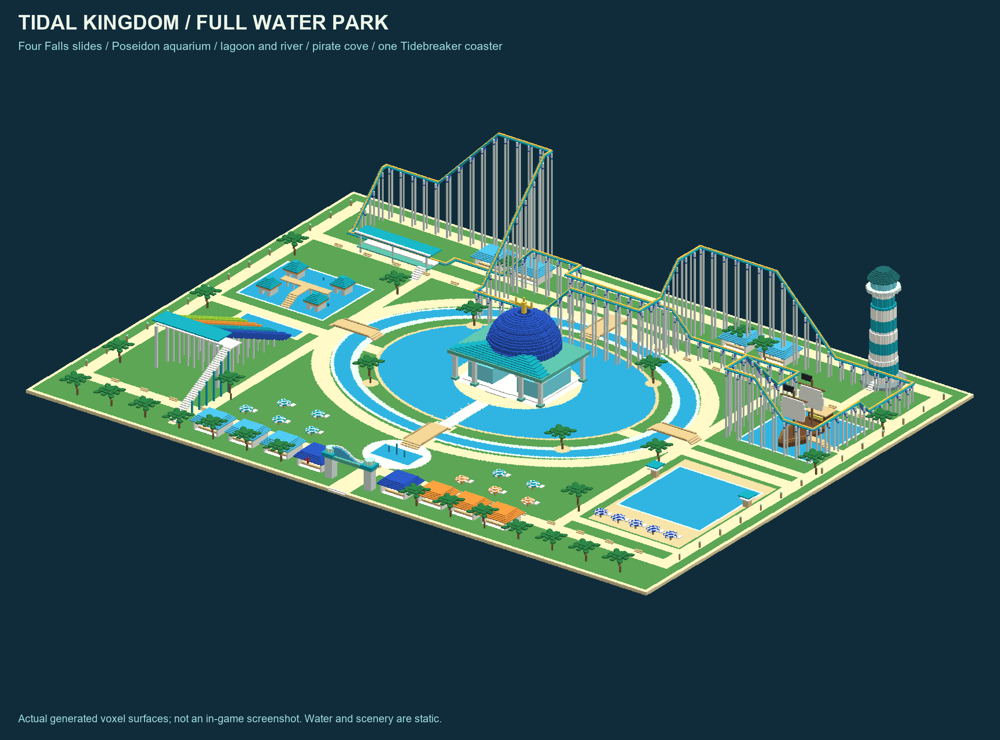
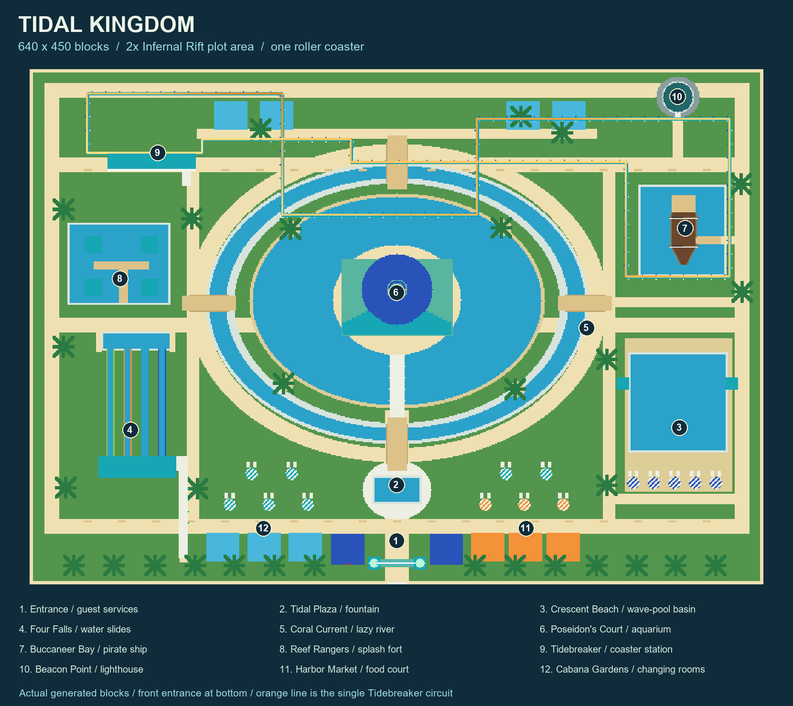
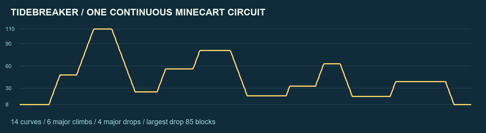

# Tidal Kingdom

A complete water-themed Bedrock park on a **640 x 450-block plot**: 288,000 square blocks, **2.00028 times Infernal Rift's 460 x 313 plot area**. The comparison is horizontal area, rather than doubling both side lengths. There is exactly **one roller coaster**.



The preview renders the generated block geometry, including supports and scenery. It is not an in-game screenshot. Minecraft playtesting remains outstanding.

## Install and place

1. Import `packs/18_theme_park_tidal_kingdom.mcpack` and activate its behavior pack in a disposable Overworld or backed-up world. Enable cheats. Bedrock **1.21.50 or newer** is required.
2. Reserve a clear, flat **640 x 450 x 119-block envelope**, including basin excavation and passenger-clearance air. Relative bounds are `^-319 ^-4 ^32` through `^320 ^114 ^481`. The highest solid is at `^111`; the extra three blocks are rail clearance. Stand at ground level with feet at Overworld **Y -60 through 205**.
3. Stand at the front-center observation origin, **32 blocks before the nearest build block**. Face a cardinal direction and look horizontally. The function centers and levels you automatically.
4. Run `/function 18_theme_park_tidal_kingdom` **once**. It saves the centered starting position and cardinal facing, then installs both halves automatically.
5. Keep **nine ticking-area slots free** and the world running until the completion message. You may move or turn after starting. Do not break the original ground block or disturb the temporary origin marker while installation is active.

Each stage preloads eight 160 x 113-or-111 rectangles, at most **88 chunks per rectangle**. A ninth ticking area preloads the origin and its neighboring chunks (circle radius one chunk; at most nine chunks) so the saved anchor remains available after the player leaves. Once **all eight** area-loaded callbacks arrive, the installer waits **600 game ticks** (30 seconds at 20 TPS) for queued placements. It then removes that stage's eight areas and waits two ticks before reusing their names for stage two. Bedrock finishes area removal after the function returns; recreating an area in the same call loses the replacement. After stage two settles, it removes all nine areas and its temporary marker and resets the active state. [Preloading](https://learn.microsoft.com/en-us/minecraft/creator/commands/commands/tickingarea?view=minecraft-bedrock-stable) and [scheduled callbacks](https://learn.microsoft.com/en-us/minecraft/creator/commands/commands/schedule?view=minecraft-bedrock-stable).

Repeated calls during installation report that the installer is busy. They do not restart it or replace its saved origin. A **3600-game-tick watchdog per stage** stops an installation if all eight areas fail to become ready. A missing anchor also stops the transition. A stopped installation cleans up its loaded marker and temporary areas and reports failure; it does not roll back placed blocks or report completion. Free nine slots and run the public function once again from the original origin to rebuild the whole park.

The origin is a persistent, invisible vanilla armor stand with direct damage resistance. Its feet and yaw are explicitly copied from the snapped player. A monotonically increasing scoreboard generation associates the marker with its installation; an older marker cannot provide the second stage's origin. The original ground must remain intact because vanilla armor stands have gravity. No custom entities, resource pack, Java NBT or experimental features are required. Terminal cleanup kills only this build's marker. A vanilla armor-stand item drop can remain at the origin. Idle scoreboard counters remain for the next installation.

The old `tidal_kingdom_next_half` player tag no longer selects a pass; the new entry point clears legacy tags and always starts a full automatic installation when idle. Reimport the updated **1.0.31** individual pack before using the one-call workflow.

Version **1.0.31** raises structure placement one block so Classic Flat ground at feet Y -60 loads from Y -64 instead of the rejected Y -65. It also inserts two-tick barriers before recreating ticking areas and resets the previous installer revision once, allowing a failed v1.0.30 installation to restart without manual scoreboard commands. The park deck is one block higher; the origin marker stays on its original ground.

Version **1.0.30** fixes the reported `Unexpected "#"` function-load errors. Every installer score counter now uses a plain name such as `tki_active`, including both operands of score comparisons. Reimport this pack, then close and reopen the world so Minecraft reloads the corrected functions.

## Attractions and guest facilities

| District | What is built |
| --- | --- |
| Tidebreaker | One supported, continuously connected powered minecart loop; covered station and half-block entrance stairs |
| Four Falls | Four colored, water-filled descending chutes, a shared runoff pool, 38-block launch deck and accessible stairs |
| Coral Current | An elliptical swimming river surrounding the central lagoon, crossed by four raised footbridges |
| Crescent Beach | Large still-water wave-pool-style basin, shallow entry shelf, loungers, parasols and lifeguard towers |
| Poseidon's Court | Trident-topped blue dome, columned temple, two sealed aquarium tanks and a dry central gallery |
| Buccaneer Bay | Enclosed harbor pool, timber galleon, gangway, cabin, masts and static sails |
| Reef Rangers | Shallow splash pool, four colorful fort towers, elevated play bridge, stairs and small fountains |
| Beacon Point | Striped lighthouse with a walkable spiral stair and observation room |
| Arrival and gardens | Wave-shaped entrance arch, guest services, first aid, fountain plaza, market, locker/changing pavilions, cabanas, benches, lamps and palms |

Water has ordinary Minecraft fluid behavior. Swim or propel a boat manually; there is no scripted current. The beach basin has **still water, not generated waves**. Sails, aquarium fish silhouettes and decorative effects are static. No animated machinery or automatic ride dispatch is installed.

For Tidebreaker, follow the paths to the rear-left station and climb its stairs. Board beside `^194 ^9 ^406`, place a minecart on the flat station track, and push toward **positive local left**, along the long platform toward the lift. The circuit has **1,632 rails**, **14 curves**, **six major climbs**, **four major drops**, an **85-block largest drop**, rail elevations **9 through 111**, and two crossings separated by **34 and 52 blocks**. Track length follows the scene layout; it was not scaled to Infernal Rift's rail count.





## Representation and validation

The park places **1,208,281 non-air blocks** and **2,560,217 explicit air cells** through **80 native structures**, 40 per automatic stage. Sparse omitted cells leave exterior world space untouched. Explicit air clears the guest envelope, stair interiors, flumes and rider corridor. Choose a new clear site: arbitrary taller existing terrain outside these clearances is not bulldozed automatically.

The public function has **41 executable lines**, including the five cardinal snaps. Two internal callbacks contain **494 commands** altogether (535 across the lifecycle). The public function saves the origin and schedules a two-tick delay so stale ticking-area removals finish. The transition callback starts both stages from the saved origin. The loaded callback counts readiness and schedules the delayed transition. The transition callback releases the previous stage and places both stages using `execute in overworld as <saved anchor> at @s rotated as @s`; it then performs completion or timeout cleanup. This explicitly restores the original dimension, position and rotation instead of inheriting a scheduled callback's server-origin context. The user-requested automatic staging extends the usual cleanup callback while retaining exactly three lifecycle functions and one public entry point. [Bedrock structure loading and rotation](https://learn.microsoft.com/en-us/minecraft/creator/commands/commands/structure?view=minecraft-bedrock-stable).

Tidal Kingdom is **build 18**, following builds 1 through 17 in this repository's retained history.

The generator verifies:

- Replay of every authored geometry operation and exact gap-preserving cuboid compression in three axis orders. Even the best tested encoding exceeds the standalone function limit.
- One closed track loop, intended rail shapes, direct power, adjacent-rail junction safety, slope approaches and passenger clearance.
- Four descending, walled water slides and contained below-deck pool water, with deliberate slide mouths treated separately.
- Fountain catchments that contain the seven-block horizontal spread, and a connected river with two clear cells over the water surface beneath every bridge.
- Walking access to all recorded guest destinations, including the launch deck, aquarium, galleon, splash bridge, boarding platform and lighthouse observation room.
- Interpretation of every emitted installer command: one-call completion in all cardinal facings after the player moves, readiness barriers, busy reentry, missing-area timeout, missing-anchor abort, old marker generations, second-stage failure and temporary-state cleanup.
- Syntax checks for every score holder in every emitted branch, including regression cases for the reported hash-prefix errors. These are conservative checks for this installer, not a complete Minecraft parser.
- Complete voxel/material maps and rotated rail states in all four cardinal directions; all 256 world-chunk alignments for every preload rectangle.
- Full little-endian NBT parsing of every asset, both index layers, dimensions, palettes, states and exact decoded source arrays.
- Every material and explicit state against [Mojang's pinned 1.21.50 vanilla block catalog](https://github.com/Mojang/bedrock-samples/blob/v1.21.50.7/metadata/vanilladata_modules/mojang-blocks.json).

Exact counts, material totals, structure dimensions and validation results are in [metrics.json](metrics.json). Its `bounds`, rail heights and landmark coordinates describe source geometry; `placement_bounds` includes the installer's one-block vertical lift. Static checks cannot establish Minecraft's fluid updates, rail auto-shaping, loading performance or ride behavior on a particular device. **Interactive ride playtesting is still required**, including fluid updates, minecart behavior and all four client-facing orientations. The headless engine check below covers automatic installation.

The corrected v1.0.30 archive was also loaded by **Mojang Bedrock Dedicated Server 1.26.52.3**. An isolated negative control reproduced the original `Unexpected "#"` error. The clean archive loaded all three functions with **zero parse errors**, registered the public function, and a plain-name score-condition probe returned the expected value. See [the engine validation report and exact function hashes](bedrock_syntax_check.json). This was a real engine syntax check, not a full park installation or ride test, and does not establish testing on every supported engine version.

## Regenerate

With Python, numpy and Pillow available, run from the repository root:

```powershell
python tools/generate_tidal_kingdom.py --verify-bedrock
python tools/generate_tidal_kingdom.py --check
python tools/cardinal_snap.py --check
python -m unittest discover -s tools -p test_tidal_kingdom_installer.py -v
.\build_ai_minecraft_pack.bat
```

The first command regenerates native assets, lifecycle functions, metrics and previews. `--check` reconstructs and validates the same content without rewriting it. Root Markdown and the manifest retain CRLF; new functions and tools use LF. Rebuild and reimport the individual pack after any packaged source changes. The root `ai-minecraft-builds.mcpack` is the complete debug alternative.

Version **1.0.31** also passed a headless installation in an isolated copy of the failing Classic Flat world at feet **Y -60**, starting with the old busy state and nine stale ticking areas. Blocks were verified in **all 80 structure regions** (40 per stage), both stages completed automatically, and all temporary areas and the marker were removed. The engine negative control also reproduced the loss of an area when its name was removed and recreated in one function call. The fixed installer waits two ticks before recreating names. See [runtime results, sampled coordinates and exact source hashes](bedrock_runtime_check.json). The harness substitutes an armor-stand driver for the player guard and adds test-only block audits; it does not establish interactive client or ride testing.
